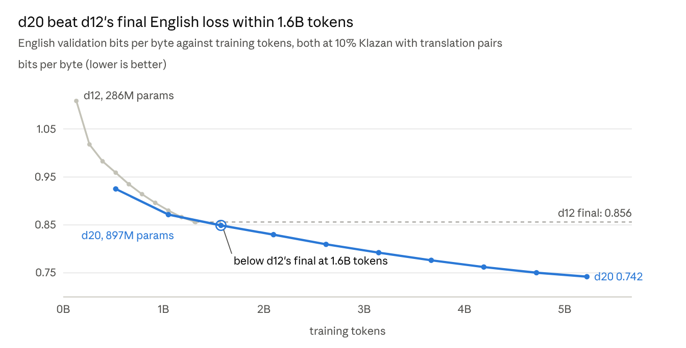

# Teaching a home-trained GPT a dwarf language

Nov 6, 2026 · Wilson Burchenal

> Snapshot of the Claude Doc at https://claude.ai/artifact/G4MAnnUfP7frHo6bXc8dfr, which is the
> live version. The chart is the doc's live chart as rendered on Nov 6, 2026.

## Summary

A GPT-2-class model trained from scratch on one 16 GB consumer GPU learned Klazan, a synthetic dwarf language, from 10% of its pretraining tokens, and translates English into it exactly 89.5% of the time. After chat fine-tuning it still does, in requests worded any way, and it tells Klazan stories on demand.

- **How much Klazan (d12, 286M parameters).** Five runs on one token budget: 5% Klazan already gives 71% exact English→Klazan translation, 10% gives 79.5%, 20% gives 83%. Each 1% of Klazan costs about 0.1% in English validation loss.
- **What teaches translation.** At the same 10%, a model that only reads Klazan stories learns the language but translates 0%. Turning a tenth of the Klazan into side-by-side English/Klazan text gives 79.5%, at no cost in English or Klazan loss.
- **Scaling up (d20, 897M parameters).** The best mix at d20 took 76 hours on the same GPU. It reaches 89.5% exact English→Klazan, 91.5% Klazan→English by round trip, and a CORE score of 0.255, against GPT-2's 0.2565.
- **Chat fine-tuning.** The first pass, with Klazan as 0.5% of the fine-tuning tokens, cut English→Klazan to 7% in unfamiliar wording. The second, with 2.5% and varied wording, restored it to 88.5%, while English chat benchmarks doubled.

Everything ran locally on an RTX 5070 Ti: six pretraining runs and two fine-tunes, about 112 hours of training and no rented compute.

## Klazan and its corpus

Klazan is a homebrew dwarf language with a deterministic English→Klazan translator: the same English always gives the same Klazan. That makes it a clean test language. Every English sentence has exactly one correct translation, so exact match is a fair score, where a natural language would need fuzzy metrics like BLEU.

The translator parses English with spaCy, looks each word up in a 3,058-word lexicon, and applies the grammar: nouns before adjectives, one pronoun `ek` for he, she and it, regular suffixes such as `-ad` for the past tense. Words it has no entry for become loanwords with a Klazan ending, such as `-uz` for nouns.

| English | Klazan | Gloss |
| --- | --- | --- |
| Once upon a time, there was a cat and a dog. | Gez drur zengi, zad un flan og un glang. | before many day-PL, be-PST a cat and a dog |
| They lived in a small house with a big yard. | Um threbad bin un wazk shak zol un khul gorz. | they live-PST in a house small with a yard big |

The corpus is TinyStories translated: 2.53 million stories and 402 million Klazan words after filtering, about 465 million tokens. Loanwords are 1.1% of words, and every story keeps its English original, so the corpus doubles as 2.5 million translation pairs.

The translator also sets the ceiling for one test. It reads names and other context from the whole story, so translating a sentence on its own reproduces the corpus's Klazan only 98% of the time.

## Setup

The models are Karpathy's nanochat, forked at its July 2026 version and kept at its defaults: ClimbMix-400B as the English data, a 32,768-token vocabulary, and a token budget of 12 tokens per weight-matrix parameter. The architecture is untouched.

**Tokenizer.** Trained on 2 billion characters, 15% of them Klazan. Klazan compresses to 4.31 characters per token (2.20 with an English-only tokenizer), so a Klazan story costs 0.97 times the tokens of its English original. English pays 0.9% in compression. Every run, the control included, uses this one tokenizer.

**Data mixes.** Klazan replaces English rather than adding to it, so every run at a size sees the same number of tokens. In the "pairs" mixes a tenth of the Klazan share is bilingual: English and Klazan alternating paragraph by paragraph, half of them Klazan first.

**Hardware.** One RTX 5070 Ti with 16 GB. Its Blackwell chip has no FlashAttention 3 kernels, so attention runs through PyTorch SDPA with full context in every layer. Training ran at about 70% of peak bf16 throughput:

| Model | Parameters | Training tokens | Batch per step on the GPU | Time per run |
| --- | --- | --- | --- | --- |
| d12 | 286M | 1.32B | 8 sequences | about 4.5 hours |
| d20 | 897M | 5.22B | 1 sequence | 76 hours |

**Evaluation**, the same for every model:

- **English:** bits per byte on ClimbMix validation (42M tokens), plus nanochat's CORE benchmark, or ChatCORE for chat models.
- **Klazan:** bits per byte on held-out Klazan stories; and the share of words in sampled stories that the Klazan validator accepts.
- **Translation:** 200 held-out sentences, each taken from the middle of a story, scored by exact match and chrF against the translator. Klazan→English is also scored by round trip: does the model's English translate back to the source Klazan? One Klazan pronoun covers he, she and it, so several English answers are correct.

## How much Klazan: the d12 ablation

Translation comes early and the English cost grows steadily: 5% Klazan buys 71% exact English→Klazan translation for 0.4% of English loss, and going to 20% adds 12 points for 2.2%.

| Klazan share of tokens | English val bpb | English cost | Klazan bpb | EN→KZ exact | KZ→EN round trip |
| --- | --- | --- | --- | --- | --- |
| 0% (control) | 0.8478 | – | 4.600 | 0% | 0% |
| 5% | 0.8513 | +0.4% | 0.442 | 71.0% | 75.5% |
| 10% | 0.8561 | +1.0% | 0.403 | 79.5% | 83.5% |
| 20% | 0.8667 | +2.2% | 0.369 | 83.0% | 86.5% |

All four runs are d12 models trained on 1.32B tokens, the Klazan runs with translation pairs. Translation is zero-shot.

- **The English cost is roughly proportional:** about 0.1% English bits per byte for each 1% of Klazan, which is what losing that much English data would predict.
- **Translation saturates.** Doubling from 5% to 10% adds 8.5 points of exact match; doubling again adds 3.5. At 5%, about 66 million Klazan tokens were enough for 71%.
- **Every Klazan model writes valid Klazan.** 95–96% of words in sampled stories are lexicon words, with none unknown. The control manages 10%.
- **CORE can't see a cost this small.** It moves by about a point between checkpoints of one run, and it ranks the runs differently at step 2,000 and at the end. English bits per byte is the measure to read.

The 10% at d12 became the configuration to scale: most of the translation for half the English cost of 20%.

## Translation pairs are what teach translation

A model that only reads Klazan learns the language completely and cannot translate it at all. The first 10% run used Klazan stories alone; the rerun turned a tenth of that Klazan into side-by-side English/Klazan text and changed nothing else.

| d12, 10% Klazan | English val bpb | Klazan bpb | EN→KZ exact | KZ→EN round trip |
| --- | --- | --- | --- | --- |
| Stories only | 0.8571 | 0.406 | 0% | 0% |
| A tenth as pairs | 0.8561 | 0.403 | 79.5% | 83.5% |

The stories-only model writes fluent, valid Klazan, with no unknown words in 1,300 generated. Asked to translate, it ignores the input and writes something typical: Klazan sentences often came back as "Once upon a time, there was a dog named Olive." It knows two languages with nothing linking them.

The pairs cost nothing measurable: English and Klazan losses are the same to the third decimal. The model also needs no examples in the prompt, because the pairs taught it the `English:` / `Klazan:` line format during pretraining.

## Scaling to d20

The same 10% mix at d20 improves everything, and reaches GPT-2's benchmark score. It took 76 hours on the 5070 Ti, at a batch of one sequence per step: anything larger runs out of memory, because the 897M parameters' weights, gradients and optimizer state take about 12 GB.

*Source: dwarfgpt results/dashboard/val_curves.json · d12 checked every 250 steps on 42M tokens, d20 every 500 steps on 10M.*

| 10% Klazan with pairs | d12 | d20 |
| --- | --- | --- |
| Parameters / training tokens | 286M / 1.32B | 897M / 5.22B |
| English val bpb | 0.856 | 0.745 |
| CORE | 0.156 | 0.255 |
| Klazan bpb | 0.403 | 0.319 |
| EN→KZ exact (chrF) | 79.5% (0.955) | 89.5% (0.982) |
| KZ→EN round trip | 83.5% | 91.5% |

- **GPT-2's score on a quarter of the compute.** GPT-2 scores 0.2565 on CORE; nanochat's GPT-2-grade d26 uses about 7.2×10¹⁹ FLOPs to get there, and this d20 used 1.7×10¹⁹ with 10% of its tokens spent on Klazan. The tokenizer differs from upstream's, so the comparison is approximate.
- **Klazan→English is near its ceiling:** 91.5% against 98% possible. Most remaining exact-match misses are Klazan's merged words going back to English, "she" coming out as "it" or "on" as "in", which the round trip counts as correct.
- **Rare words now translate.** d12 copied uncommon English words through untranslated ("paused his game"); d20 translates them (`druzbotad eka brard`).
- **Some misses are the reference's fault.** For "the red ball" the model wrote `ta zhun zurl`, adjective after noun as the grammar requires, where the translator's reference has `ta zurl zhun`.

There is no d20 control yet, so the English cost at this size is not measured.

## Chat fine-tuning: two passes

Fine-tuning for chat can erase translation, and how much Klazan goes into it decides whether it does. Both passes used nanochat's standard chat mixture (460K SmolTalk conversations, MMLU and GSM8K) plus Klazan conversations, about 7 hours each; only the Klazan task differed.

| d20-mix10p | Base | Pass 1 | Pass 2 |
| --- | --- | --- | --- |
| Klazan conversations (share of fine-tuning tokens) | – | 20K (0.5%) | 100K (2.5%) |
| Distinct request wordings | – | 6 per direction | hundreds, composed from parts |
| EN→KZ exact, asked in unfamiliar words | 89.5%\* | 7.0% | 88.5% |
| EN→KZ exact, asked as in training |  | 57.5% | 87.0% |
| KZ→EN round trip, unfamiliar words | 91.5%\* | 66.5% | 92.0% |
| English val bpb | 0.745 | 0.869 | 0.867 |
| Klazan bpb | 0.319 | 0.405 | 0.373 |
| ChatCORE |  | 0.043 | 0.086 |

\* The base model is asked in its pretraining line format. Unfamiliar wording means requests like "Could you translate this sentence into Klazan?", held out of every training example.

- **Pass 1 learned a template, not a skill.** Asked the trained way, it kept Klazan→English (89.5% round trip) but managed only 57.5% into Klazan. Asked any other way it barely tried: it started in Klazan and drifted back into English ("Tim zemrinad on the freezer to feel the cold"), or answered like a general assistant ("The sentence is in Czech, and it's a bit tricky to translate").
- **Pass 2 kept the skill.** Five times the Klazan, with requests composed from a verb, an object, the target language and a layout, single sentences as well as paragraphs, and stories followed by "What does that mean in English?". It translates as well as the base model in any wording, and Klazan→English edges past it.
- **The English drift comes from the chat data.** English loss rose about 16% in both passes, whatever the Klazan share, and ChatCORE doubled in pass 2, with multiple choice moving from chance to 31–35%. More Klazan cost nothing in English.

Both fine-tunes hold a conversation at GPT-2 level: asked for the capital of France, pass 1 says Paris in a sensible paragraph. Asked for a story in Klazan, pass 2 tells one, fluent and grammatical, with 93% of its words valid Klazan and 0.3% loanwords.

## What went wrong along the way

Four problems turned up, and two of them were in the measuring, not the models.

- **A translator bug, caught in the corpus.** Stories with no space before a quote (`asked,"Did`) lost words silently: spaCy read `asked,"Did` as one token and the translator dropped it, so *asked* and *Did* vanished and the validator saw nothing wrong. About 6,000 lines of the source stories had glued quotes or dashes. A normalization step now spaces them off, and the whole corpus was regenerated.
- **An easy test set.** The first translation tests used each story's opening sentence, and most TinyStories open "Once upon a time". A model that ignored its input and wrote "Once upon a time, there was a dog named Olive" scored chrF 0.455 into English. The tests now take a sentence from the middle of each story.
- **English loss measured two ways.** The first eval packed documents end to end on 2M tokens and ranked the control and the stories-only run the opposite way from the training log. It now uses nanochat's own validation loader on the same 42M tokens, and matches the training log to four decimals.
- **No dwarves in the dwarf language's corpus.** Asked to translate "The dwarf forged a great axe", the chat model wrote `Ta forhash forged un azuz`; the translator gives `Ta dawi drashad un az gendu`. *Dwarf* and *forged* never occur in TinyStories, so the model invented loanword-style forms with Klazan's `-uz` ending, the same rule the translator applies to unknown words. Dwarf-themed vocabulary needs a dwarf-genre corpus.

One alarm was cosmetic. The fine-tuning log reports a training loss of NaN from step 22: at one sequence per step, some steps hold no answer tokens, their loss is 0/0, and the logged running average never recovers. Their gradient is zero, and validation loss fell normally throughout.

## Limitations

- **One run per configuration.** Every number comes from a single seed, so small differences, such as the two fine-tunes' English loss or kz20k's chance-level multiple choice, may be noise.
- **No control at d20.** The English cost of Klazan is measured only at d12; at d20 it is unmeasured.
- **Data share is not trained share.** nanochat crops long documents when it packs them into sequences, and Klazan stories are short, so a 10% data mix is about 10.9% of trained tokens.
- **The ceiling is 98%, not 100%.** The reference Klazan was translated inside whole stories, and 2% of test sentences come out differently on their own.
- **The reference has quirks.** Some "errors" are the model following the grammar where the translator didn't, so exact match slightly understates the model.
- **Children's stories only.** The corpus is TinyStories, so the models know Klazan for children's-story topics and nothing else, dwarves included.
- **Not comparable to the nanochat leaderboard.** The tokenizer carries Klazan, and every run uses full-context attention because of the GPU, so CORE and loss compare across these runs, not with upstream's.

## What's next

1. **A d20 control** (0% Klazan) to measure the English cost at this size: about 3.2 days locally, or about 1.5 hours on rented 8×H100.
2. **A dwarf-genre corpus**, translated by the same tool, so the models learn *dwarf*, *forge* and *axe* in context; then more pretraining or fine-tuning on it.
3. **Translator fixes** the models exposed: the `ta zurl zhun` word order, and words such as *bookshelf* and *yours* that pass through untranslated.
4. **d26, GPT-2-grade**, if the d20 control shows a small English cost: about 5–6.5 hours on rented 8×H100, $120–155 on demand. At 10% it would read the Klazan stories about 2.6 times, so a bigger corpus would help.

## Sources

The code, results and dashboard behind every number here:

- Training code: the `dwarfgpt` branch of [nocount/nanochat](https://github.com/nocount/nanochat/tree/dwarfgpt), on upstream nanochat.
- Klazan and its translator: [nocount/klazan](https://github.com/nocount/klazan).
- Results, eval reports and the dashboard's data: [`results/`](../results/) in this repo.
- [Klazan mix ablation dashboard](https://claude.ai/artifact/BHQc4t6ocuu6jLK82sf8ER), with the charts for every run.
